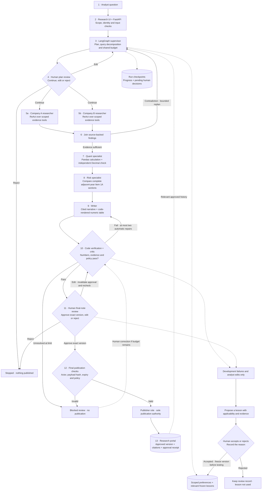
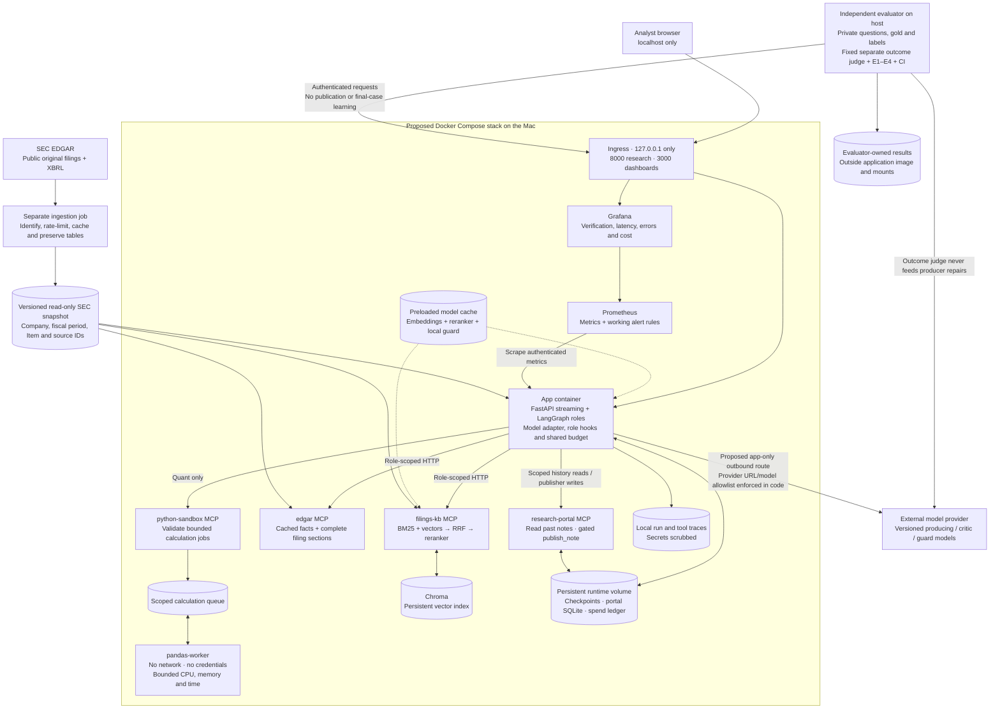

# Analyst Desk: architecture v1

**Group 22 | Prepared 22 October 2026; portable export 24 October 2026 | AI-assisted design for team review**

This is the proposed architecture following our [project definition](PROJECT_DEFINITION.md) and [evaluation plan](EVALUATION_PLAN.md). It defines the system we intend to justify and build. The current implementation is being built step by step in this repository; this proposal records no student approval, new benchmark result or completed deployment.

## 1. Boundaries and main decisions

Version 1 serves one analyst on a local workstation, with six students sharing development responsibilities. It covers the twelve selected Technology/Healthcare issuers and fiscal 2023–2025. The analyst requests company research, inspects sources, edits plans and signs notes. Cloud hosting and production multi-user tenancy are outside this first version.

Use FastAPI with streamed progress, LangGraph for the supervisor and specialist workflow, four FastMCP services, Chroma plus BM25 retrieval, SQLite persistence and Docker Compose. Company researchers run in parallel; quant and risk stages run sequentially after their evidence joins. This keeps dependencies and traces easy to explain before adding more concurrency.

The diagrams separate logical work from deployed processes:

- [Overview drawing](diagrams/architecture-v1-overview.png) and [scalable vector version](diagrams/architecture-v1-overview.svg).
- [Research workflow — editable diagram](diagrams/architecture-v1-workflow.mmd).
- [Docker services and data boundaries — editable diagram](diagrams/architecture-v1-deployment.mmd).

Agents are roles inside the application workflow. Each role does not require a separate container or a separately paid model.

## 2. One request through the architecture

1. **Request and scope.** The research UI sends a question, selected companies/years and a request identifier to FastAPI. Input rules validate coverage, size and permitted research scope. Retrieved text is always untrusted evidence. The system states unsupported scope explicitly.
2. **Plan.** The LangGraph supervisor creates subquestions, evidence requirements and an outline. Code enforces tool/token/spend limits. The analyst can edit the plan; our proposed UI pauses for a plan decision before execution. A persistent checkpoint saves this review position.
3. **Parallel company research.** One bounded researcher branch per company retrieves Item 7, Item 1A and table evidence through the filing and EDGAR services. Specialists use ReAct: choose an allowed tool, inspect its result and decide the next step within budget. Hybrid search combines BM25 and vectors with reciprocal-rank fusion, query decomposition and reranking. Handoffs retain passage/fact identifiers.
4. **Replan and join.** The supervisor joins typed branch results. Missing or contradictory evidence causes a bounded revised evidence strategy, rather than confident completion of the original outline. The scope and remaining budget remain visible.
5. **Quant.** The quant role obtains canonical revenue and operating-income facts. Code matches issuer, original concept, accession, fiscal dates, currency, units and scale. A restricted pandas calculation runs in the isolated worker; independent Decimal arithmetic verifies the result. Preserve unrounded inputs/results and show two-decimal margins under the evaluation policy.
6. **Risk comparison.** The risk specialist compares the complete adjacent-year Item 1A evidence and proposes supported changes with both source versions. Retrieval absence does not prove removal; wording changes do not establish material economic changes. Uncertainty remains explicit.
7. **Draft and critic.** The writer creates a cited note from structured findings; code renders the financial table. The critic verifies numbers, claim support and prohibited wording. Failed drafts receive at most two automatic repair rounds within the original budget. Output guards check citations and disclosures before review and publication; edits repeat these checks.
8. **Exact-note human review.** A passing draft pauses for approve, edit or reject. Edits invalidate approval and return through verification. They do not reset automatic repair counters or the overall budget. A critic failure after the repair limit blocks publication; fixing and rechecking are required before a new approval can become valid.
9. **Publication.** Only the publisher role can call `publish_note`. Code binds approval to the analyst, run and exact payload hash, with an expiring capability. The portal checks the stored approval inside its transaction. An idempotency key prevents duplicate publication after retries or recovery.
10. **History and follow-up.** Approved notes enter the analyst's research history. A later request can retrieve relevant approved notes to answer what changed. Trace records preserve decisions, sources, tool use, failures, tokens and cost without storing credentials.

## 3. Roles and permitted tools

Permissions come from authenticated code scopes, never from a model claiming a role.

| Role | Responsibility and permitted access |
|---|---|
| Supervisor/planner | Select scope, plan, route, replan and retrieve bounded approved memory. No publication authority. |
| Company researchers | Read filing search, passages, sections and source facts for approved company/year scope. |
| Quant | Read canonical facts and submit restricted calculation jobs. No arbitrary shell or publication. |
| Risk specialist | Read complete adjacent-year sections and evidence comparisons. No arbitrary web search carrying private memory. |
| Writer | Compose from typed findings. No direct tools or write credentials. |
| Critic | Independent numeric/policy verification and bounded evidence reads; semantic checking uses its configured model. No publication. |
| Publisher | Write one exact approved note through the portal. No general database or external-action access. |

Read access to past notes is actor-scoped and selected by the supervisor; it does not grant access to other actors or unrestricted memory dumps. The single-agent baseline receives the equivalent read/calculation tools and budget, without publication authority.

## 4. Four MCP services

| Service | Contract and storage boundary |
|---|---|
| `filings-kb` | Company coverage, hybrid search and cited passages; reads the frozen corpus and Chroma index. Source text remains data. |
| `edgar` | Cached filing lists, sections and canonical facts. Research calls use the frozen snapshot, not arbitrary URLs or silent live refresh. |
| `python-sandbox` | Validated calculation requests/results; exchanges bounded jobs with the isolated pandas worker through a queue volume. |
| `research-portal` | Scoped past-note reads and approved publication; accesses the portal database and approval records. Only publisher credentials allow publication. |

Use typed inputs and an `{ok, data, error}` result envelope with stable error codes. Before each tool call, hooks check scope, permission and remaining budget; afterwards they record timing, outcome and scrubbed diagnostics. Failed attempts consume their declared budget. MCP HTTP endpoints are internal and require role-scoped credentials.

During development, the same schemas may use local stdio MCP transport; Docker uses authenticated HTTP. Direct function calls in a teaching mode do not establish that MCP transport works. Prove both transport paths before claiming them.

Layer deterministic scope, permission and redaction rules with the planned local injection classifier (Prompt Guard 2), safety classifier (Llama Guard 4) and output checks. Obtain permitted model access and preload required local weights before isolated operation. Missing required security dependencies or malformed verdicts block the affected live operation; an explicitly labelled teaching mode is separate. Measure trained-guard effectiveness in E2 before making security-quality claims.

## 5. State, handoffs and API contracts

The proposed run state contains `run_id`, `actor_id`, question/scope, source snapshot hash, plan/version, stage, remaining budgets, branch results, evidence issues, numeric rows, risk findings, draft/version/hash, critic verdict, repair count, human decision, publication receipt and error status.

Each specialist handoff contains role, scope, status, fact/passage IDs, findings, uncertainties and usage. Reject malformed output and unknown references. Trim or summarize older observations while retaining acquired-fact IDs and scope; checkpoints provide persistence, not unlimited model context.

Logical API contracts are: create research, stream run events, inspect a run, submit a version-bound plan decision, submit a version-bound note decision, inspect approved notes and manage permitted preferences. These are design contracts; route names and payloads must be defined and validated in the current implementation. Decision requests carry the expected version/hash, and conflicting or stale decisions fail explicitly.

On restart, resume from persisted state and revalidate budget and approval expiry. Missing/incompatible facts produce an incomplete or unsupported result. Timeouts and provider errors remain recorded failures; they do not trigger uncontrolled retries, host calculation fallback or silent substitution of synthetic data.

Working v1 limits are at most four companies and three fiscal years per request, four researcher branches, one supervisor replan and two automatic critic repairs. A calculation job has a ten-second limit in the networkless worker with bounded CPU, memory and processes. Human edits do not replenish counters or spend. Exact tool/token/currency caps and active-run timeout must be explicit in the versioned run configuration before execution; missing paid authorization blocks live requests. Set performance caps on development evidence before the final freeze. These are design defaults to validate, not measured capacity claims.

## 6. Memory and durable data

| Store | Contents and rules |
|---|---|
| LangGraph checkpoints, SQLite | Current question, plan, evidence references, progress and pending reviews; survive application restart. |
| Scoped LangGraph store, SQLite-backed | Allowlisted analyst preferences, coverage metadata and reviewed lesson records. Retrieve relevant bounded context only. |
| Research portal database | Approved note bodies, source/derivation references, versions, approval audit records and publication receipts. |
| Source snapshot and Chroma volume | Public filings, retained tables, canonical facts and retrieval indexes; distinct from analyst memory. |
| Runtime usage/audit storage | Tool/model events, budget reservations and observed usage, with secrets scrubbed. |

Application and portal processes share the intended local runtime volume, with transactions, bounded write concurrency and database busy handling. Logical store boundaries do not imply operating-system isolation between processes sharing SQLite files. Review the [memory policy](MEMORY_POLICY.md) for retention, inspection, correction and deletion; deleting preferences must not silently erase signed publications or audits.

Private watchlists never enter model prompts, external queries or outbound traces. Credentials remain in private configuration, not memory. Proposed lessons from actual development failures stay pending until a person accepts or rejects them with a reason. Retrieve only relevant accepted lessons from a frozen version. Held-out cases cannot generate lessons or published history.

## 7. Docker and external boundaries

Loopback ingress exposes the UI/API and Grafana on the Mac. The application runs FastAPI, LangGraph and the model adapter; MCP servers, Chroma and Prometheus remain on the internal backend. Grafana reads monitoring data. Initialization supplies scoped credentials. A proposed app-only provider-egress network permits model calls; MCP services remain backend-only. SEC ingestion uses a separate outbound preparation job.

The pandas worker has no network, provider keys or Docker socket. Its only shared resource is the bounded queue volume; it validates jobs again, enforces resource/time limits and returns structured results. The HTTP sandbox service can communicate with the application, while the actual calculation worker cannot reach the network.

Persistent volumes retain checkpoints, portal/history, indexes, model caches and monitoring data. Mount frozen source data read-only into the services that require it; keep application code read-only. Cache/index construction and SEC ingestion are separate preparation operations, using an identifying SEC contact, rate limiting and local caching before a source snapshot is frozen.

Only the model adapter sends bounded prompts/public evidence to OpenRouter. Code allowlists provider base URLs and exact model IDs; this is not an OS-enforced domain allowlist. Stronger proxy restrictions are a later pilot decision. Version prompts, sampling and budgets together. Select/test models later; previous caps are not new spending authorization. This task makes no paid calls. Outbound tracing requires a separate decision.

## 8. Evaluation and operating evidence

The independent evaluator runs outside the deployed agent boundary. The full protected dataset, expected answers and labels stay outside application images, mounts and tools. Each submitted ordinary question and its output may enter that evaluation run's isolated state, checkpoints and audit records; define their access and retention, and never promote them into shared preferences, lessons or approved-note history. Evaluation stops at note review without publication. A fixed, calibrated different-family outcome judge scores all experimental arms and cannot feed verdicts back to the producer.

E1 shares producing models, tools, budgets, deterministic verification and the separate outcome judge. C0 follows a fixed sequence without adaptive critic routing; C1 uses one ReAct producer; C2 includes supervisor/specialists and its critic loop as the architecture treatment. Fix critic configuration whenever enabled. E4 varies C2's critic/table handling while retaining deterministic checks, human approval, safety controls and independent scoring. Freeze lessons/configuration before final evaluation.

Prometheus/Grafana show verified-number share, critic rejections, tokens/cost, cache hits, errors and latency. The below-98% verified-share alert is an operating signal; it does not authorize publication of unchecked figures. See the [evaluation plan](EVALUATION_PLAN.md) for E1–E4 and three-repeat reporting.

## 9. Tradeoffs, gaps and verification

SQLite and one local analyst minimize setup; a shared pilot would require real identities, stronger authorization, PostgreSQL/queues, backup/deletion procedures and concurrency design. Parallel company research adds coordination cost; its value must be measured against simpler baselines. A bounded critic controls cost but can leave a failed draft unpublished.

| Current build work | Evidence required before completion |
|---|---|
| Source preparation and learned retrieval | Verified real SEC source snapshot, scoped read-only mounts, index and retrieval measurements. |
| Model/provider integration | Explicit budget authorization, working permitted model access and tested provider-egress boundary. |
| Financial display and verification | Two-decimal display derived directly from precise calculations, with source-linked independent checks. |
| Baselines and evaluator | Fixed C0, one-producer C1 and team/critic C2 with fair caps and separate outcome scoring. |
| Complete deployment | All proposed services starting together, persistent volumes and observed security/monitoring checks. |

The Docker-based local journey is under construction. Diagram preparation and static artifact validation do not establish a running full stack or live model access.

Before calling the architecture implemented, demonstrate: restart/resume; contradictory evidence causing replan; numeric/fiscal/unit checks; two-round repair termination; an edit invalidating approval; expired/stale approval rejection; idempotent publication; blocked worker network access; memory correction/deletion; protected evaluation separation; full Compose startup; and a working alert/failed CI gate. Link each claim to actual evidence, not this diagram.

**Authority:** course-supplied Capstone architecture and build guide (PDF not redistributed here), pp. 2–6 and 15–17. The team must review, redraw and explain these decisions for its own submission.
