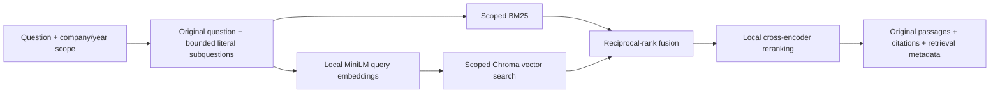

# Step 12: hybrid retrieval and reranking

The filing search now combines exact word matches with learned semantic similarity, then reranks the combined candidates. It searches the frozen twelve-company FY2023–2025 dataset and returns the original passage records with their SEC citations.

## Search pipeline



1. Validate the issuer, fiscal years, query length and requested result count against the frozen catalogue.
2. Keep the original question and extract at most two literal subquestions around conjunctions, semicolons or question boundaries. This is a deterministic query technique; it does not generate new questions or facts.
3. Search only the permitted company/year rows. BM25 ranks matching words; a pretrained MiniLM encoder maps the query into the same vector space as the cached filing passages.
4. Combine the top 24 candidates from each channel and query variant with reciprocal-rank fusion: each ranked occurrence contributes `1 / (60 + rank)`. Canonical passage IDs merge duplicate candidates.
5. Score at most 24 fused candidates with a pretrained cross-encoder that jointly reads the original question and each candidate. Return at most ten passages, normally five, with deterministic ID-based tie breaking.

All arms search the same representation: passage text plus retained table cells when available. The returned `text`, table and source URL remain the original corpus fields. Retrieval metadata records the arm, backend, query variants, component scores and frozen fingerprints.

The implementation follows the [Sentence Transformers retrieve-and-rerank pattern](https://sbert.net/examples/sentence_transformer/applications/retrieve_rerank/README.html). The cross-encoder returns raw relevance scores; these are not calibrated probabilities or evidence that a financial claim is correct.

## Files and responsibilities

| File | Purpose |
|---|---|
| [retrieval.py](../desk/retrieval.py) | Shared table-aware representation, query decomposition, BM25, learned encoding, fusion, reranking and artifact verification. |
| [data.py](../desk/data.py) | Corpus access, explicit retrieval modes and lightweight retrieval readiness. |
| [retrieval_config.json](../data/retrieval_config.json) | Frozen model revisions, public-file checksums, text/query policies and ranking limits. |
| [prepare_retrieval.py](../ops/prepare_retrieval.py) | Offline preparation of model files, normalized vectors and the fingerprinted manifest. |
| [vector_store.py](../desk/vector_store.py) | Chroma population and read adapter, collection integrity checks and issuer/year/ID filters. |
| [prepare_vector_store.py](../ops/prepare_vector_store.py) | Explicit operator population of Chroma from already prepared vectors. |
| [requirements.retrieval.txt](../requirements.retrieval.txt), [Dockerfile](../Dockerfile), [compose.yaml](../compose.yaml) | CPU model dependencies, image packaging, read-only model mount and the internal vector-store connection. |
| [retrieval development pack](../evaluation/retrieval/README.md) | Frozen public development questions, partial relevance labels and the paired comparison protocol. |
| [test_retrieval.py](../tests/test_retrieval.py), [test_vector_store.py](../tests/test_vector_store.py), [test_retrieval_evaluation.py](../tests/test_retrieval_evaluation.py) | Scope isolation, artifact integrity, ranking, vector-store and measurement checks. |

## Models and text limits

| Role | Public model | Frozen revision | Processing |
|---|---|---|---|
| Encoder | [all-MiniLM-L6-v2](https://huggingface.co/sentence-transformers/all-MiniLM-L6-v2) | `1110a243fdf4706b3f48f1d95db1a4f5529b4d41` | 384-dimensional normalized vectors; 254-token content windows with 32-token overlap, averaged and normalized per passage. |
| Reranker | [ms-marco-MiniLM-L-6-v2](https://huggingface.co/cross-encoder/ms-marco-MiniLM-L-6-v2) | `233902d25c440f23af6f7d6e94d2946bac0bee0a` | Maximum 512-token pair; query limited to 96 tokens, remaining document windows overlap by 32 tokens; maximum window relevance is the passage score. |

Both models run on the CPU from verified local safetensors files with remote code disabled. Long documents use windows rather than dropping the document tail. Inputs above 32,768 tokenizer tokens are rejected. Query text is limited to 2,000 characters; reranking still uses only the first 96 query tokens. Window averaging and maximum-window reranking are declared retrieval policies that need evaluation on the intended questions.

## Prepare a fresh machine

Run these commands from the Analyst Desk folder using its Python environment. First prepare and verify the SEC corpus as described in the [source guide](../data/README.md).

Install the application and CPU retrieval dependencies:

```sh
python -m pip install -r requirements.txt -r requirements.retrieval.txt
```

The Docker image installs the official CPU build `torch==2.14.1+cpu`; the portable Python dependency file pins `torch==2.14.1` for host installation. Sentence Transformers, Transformers, safetensors and the Chroma client are pinned separately. The live Compose overlay assigns the same current application image to every Python service, including the tools and isolated calculation worker, so their code and dependencies stay aligned.

Download only the pinned public model files during preparation. This network step needs no provider credential or Hugging Face token:

```sh
python - <<'PY'
from pathlib import Path
from huggingface_hub import snapshot_download
from desk.retrieval import load_config

cache = Path.home() / ".cache/huggingface/hub"
config = load_config()
for role in ("encoder", "reranker"):
    model = config[role]
    snapshot_download(
        repo_id=model["id"], revision=model["revision"],
        allow_patterns=list(model["files"]), cache_dir=str(cache), token=False,
    )
PY
```

Then build the retrieval bundle entirely offline from those cached public files:

```sh
python ops/prepare_retrieval.py \
  --corpus .runtime/journey/sources/corpus.json \
  --model-cache "$HOME/.cache/huggingface/hub" \
  --output .runtime/journey/retrieval
```

The bundle contains `manifest.json`, `vectors.npy`, a preparation receipt and the allowlisted model files under `models/encoder` and `models/reranker`. The manifest binds the source fingerprint, ordered canonical passage IDs, issuer/year scope, retrieval-text hashes, configuration, model files and vector checksum. Current preparation covers **4,073 passages × 384 dimensions**.

Preparation reuses a complete matching bundle. A stale or incomplete existing destination fails instead of being overwritten. For a new source or configuration, prepare into a new directory, stop the readers, switch the configured read-only mount and restart them together. Preserve the prior source and artifacts when retaining runs that depend on them. Generated bundles, raw sources and local caches stay outside Git.

## Docker startup and Chroma population

The Compose configuration selects `hybrid_rerank`. Only the filing search service mounts `.runtime/journey/retrieval` at `/retrieval`, read-only. It connects to Chroma over the internal backend network; model preparation and runtime retrieval do not require provider egress.

Use the existing launcher after preparing the source and model bundle:

```sh
python ops/start_journey.py --start
```

For an already prepared live-model installation:

```sh
python ops/start_live.py --start
```

The startup sequence starts Chroma before the filing service, then runs the explicit vector-population command. Population reads the frozen vectors and creates an index-specific collection; it does not embed text or download models. An existing collection is reused only when its fingerprints, count, canonical IDs, metadata and every stored float32 vector match the prepared bundle. Stored-vector comparison allows an absolute tolerance of `1e-7` with zero relative tolerance; the observed float32 roundoff was approximately `1.5e-8`. Query-time code only reads the collection and cannot silently create or rebuild it.

The operator command used inside the prepared Compose environment is:

```sh
python ops/prepare_vector_store.py \
  --corpus /sources/corpus.json \
  --artifacts /retrieval \
  --chroma-url http://chroma:8000
```

Every vector query applies issuer, fiscal-year and allowed-passage-ID filters before ranking. Returned IDs and scope metadata are checked again. Missing models, a stale source/index, an invalid collection or unavailable Chroma stops learned retrieval with a clear setup error. Startup and retrieval do not create a research request, approve a plan, publish a note or spend a generative-model budget.

## Configuration and comparison modes

| Setting | Meaning |
|---|---|
| `RETRIEVAL_MODE=bm25` | Explicit lexical baseline; no model or vector artifacts are required. |
| `RETRIEVAL_MODE=hybrid` | BM25 plus learned vector retrieval and reciprocal-rank fusion. |
| `RETRIEVAL_MODE=hybrid_rerank` | Hybrid retrieval followed by the local cross-encoder; selected for Compose. |
| `RETRIEVAL_ARTIFACTS` | Prepared bundle directory; `/retrieval` in the filing container. |
| `CHROMA_URL` | Local Chroma endpoint. When absent, learned search uses the same prepared vectors through exact NumPy cosine ranking for local development comparisons. |
| `RETRIEVAL_CPU_THREADS` | CPU inference threads, bounded to one through four; default two. |

Python callers can select one arm using `Corpus.search(..., retrieval_mode="bm25")`, `"hybrid"` or `"hybrid_rerank"`. The three arms share source scope and table handling. A learned mode does not fall back to BM25 when setup fails. Changes to model revisions, text policy, query policy or ranking settings require a new configuration/index fingerprint and a declared comparison version.

## Observed development comparison

The frozen pack contains **36 questions and 42 partial relevant-passage labels** across MSFT, AAPL, ABBV and AMGN for FY2023–2025. Questions form twelve related topic families. All twelve companies are indexed, while this comparison uses only the four declared development issuers.

The host CPU comparison uses exact NumPy vector ranking and the frozen table-aware representation in every arm. It produced:

| Arm | Sampled-label Recall@5 | Hit@5 | Queries improved / regressed / unchanged versus BM25 | Errors |
|---|---:|---:|---|---:|
| BM25 | 75.00% | 77.78% | Baseline | 0 |
| Hybrid | 77.78% | 83.33% | 5 / 5 / 26 | 0 |
| Hybrid + reranking | 98.61% | 100.00% | 9 / 0 / 27 | 0 |

These are builder-prepared, source-derived development labels, not independently reviewed gold or protected final cases. Labels are partial; unlabelled passages can also be relevant. The results do not establish final capstone accuracy, exhaustive relevance, financial correctness or an improvement on every future query. Chroma uses its own vector index, so deployed checks are separate from this host comparison. Initialization and cache warming differ across arms; these elapsed times are not a controlled latency benchmark.

See the [comparison protocol](../evaluation/retrieval/README.md) and [public result receipt](../evidence/retrieval_development_comparison.json).

The [deployed Chroma/MCP check](../evidence/retrieval_deployed_verification.json) also passed: **36 of 36 development queries completed, zero errors, 98.61% sampled-label Recall@5 and 100.00% Hit@5**, through 37 authenticated tool calls including retrieval readiness. All 36 deployed top-five passage orders matched the host comparison. The deployed check used local embeddings and reranking, created no research runs or notes, and issued no generative-model or external provider requests. The same partial-label and development-split limits apply.

The [final runtime and persistence check](../evidence/retrieval_deployment_runtime.json) records **780 passing local tests and 19 passing runtime checks**, all twelve company tool paths, 36 margin rows with 108 verified values, and 72 section groups. Restarting Chroma and the filing service reused all 4,073 vectors; representative Technology and Healthcare searches returned the same passage IDs in the same order. Existing runs, spending records and all three saved notes were unchanged. The served browser script matched the reviewed source file.

To reproduce the host comparison against the prepared bundle:

```sh
CHROMA_URL= RETRIEVAL_ARTIFACTS=.runtime/journey/retrieval \
python ops/evaluate_retrieval.py \
  --corpus .runtime/journey/sources/corpus.json \
  --queries evaluation/retrieval/development_queries.jsonl \
  --expected-query-sha256 ab0e30ef73499e4adb8f1385e0f9af9f459e1504cc42c77be8a0107769d22d9a \
  --output .runtime/retrieval/development_comparison.json
```

## Capstone relationship and remaining limits

This step implements the hybrid search, query technique, reranking and persistent vector-store path drawn in the [architecture](ARCHITECTURE_V1.md). The 36-query comparison supplies development evidence toward the [evaluation plan's](EVALUATION_PLAN.md) retrieval comparison. Human relevance review and independently owned final cases remain outstanding.

Better ranking cannot repair missing source material. Original SEC Item boundaries, complete table extraction and economic risk interpretation remain unverified. Retained cells are searched as supplied; no new table parsing is introduced in this comparison. Canonical annual facts and deterministic margin verification remain separate from passage relevance. Human plan approval and final-note approval still apply to research runs.
