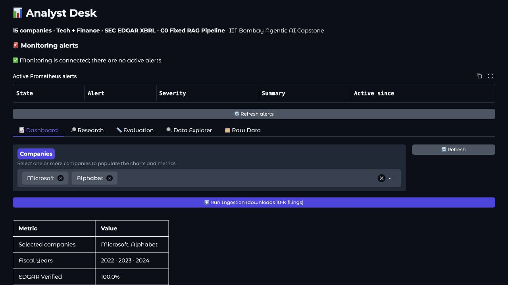
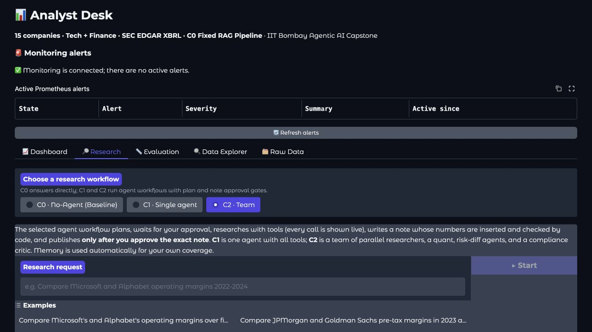
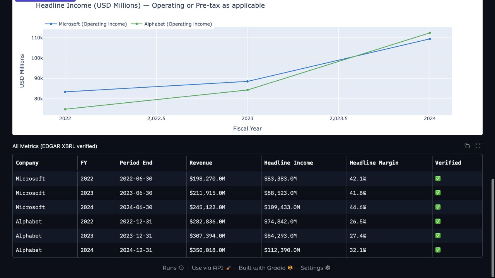

# Analyst Desk Three Story Demonstration

Final presentation route approximately 12 minutes

This is a complete, evidence-led presentation route that can be delivered from the submitted files without starting research, changing memory or publishing a note. It explains three analyst decisions and the implementation evidence available for each. The [demo evidence index](DEMO_EVIDENCE_INDEX.md) identifies every exhibit and its limits.

The completed product assessment of the selected Microsoft/Alphabet draft is **Not accepted for publication as submitted; assessment complete**. Its original application state remains a historical `waiting_note` result with failed checks. Completing this assessment did not approve, edit, reject through the app or publish that note.

## Evidence labels and running order

| Label | Meaning in this presentation |
|---|---|
| RECORDED UI | Authentic screenshots captured for the 8 November guide; historical state, not the latest live application |
| HISTORICAL RUN | Saved C2 request `comparison-20261109-c2`, revision `42e2298`, identified by task, note fingerprints and check summary |
| CURRENT COMPONENT | Offline checks of source revision `33fef7f`; synthetic fixtures and isolated tests, not a complete live story |
| WORKED EXAMPLE | Presenter arithmetic or an explanation of an expected decision; not a generated application result |
| NOT DEMONSTRATED | The submitted evidence does not establish that behaviour end to end |

Allow 30 seconds for the opening, four minutes for Story 1, three minutes for Story 2, three minutes for Story 3 and 90 seconds for the close. These are presentation allowances, not model response-time promises. Show only the indicated files and result fields; keep credentials, signing material and private context off screen. The supplied route uses no real watchlist.

## Opening

**Say:** “Our user is an equity research analyst preparing a company-comparison note. Analyst Desk retrieves annual filing evidence, calculates figures and drafts an inspectable note. The analyst decides whether that exact note is eligible for publication. I will distinguish recorded application behaviour, current component checks and outcomes that have not been demonstrated.”

**Show:** Figure 1 and the evidence-label table. The project covers 15 companies in technology and finance over FY2022–FY2024.

**Check:** A dashboard verification tick describes stored data checks; it does not certify the completeness or interpretation of a research note.

Figure 1. RECORDED UI. Microsoft and Alphabet are selected. The summary lists FY2022–FY2024 and “EDGAR Verified 100.0%”. This is a stored dashboard state, not acceptance of the selected draft.

## Story 1 Compare companies and make an evidence based acceptance decision

### Step 1 Establish the actual question and approved research scope

**Say:** “The recorded question asks for Microsoft and Alphabet operating margins for FY2022–FY2024 and supported changes in risk disclosures. The plan also requires source-backed explanations, appropriate uncertainty and actual fiscal-period differences.”

**Show:** Figure 2, then the [case metadata](evidence/product_domain/product_acceptance/CASE_METADATA.json) and selected assertions in the acceptance review. Explain the workflow roles: company researchers gather commentary, quant handles figures, risk specialists compare disclosures, the writer combines findings and the critic checks selected claims.

**Check:** The local assessment records a research-approved scope, stopping at the note gate with no publication. Raw plan and approval bodies are excluded from the public evidence. The selected workflow is C2; the persistent page subtitle mentioning C0 does not identify this run's actual mode.

Figure 2. RECORDED UI. “C2 · Team” is selected; “Research request” is empty and “Start” is disabled. This locates the controls; it is not an executing job.

### Step 2 Inspect the figures dates and source basis

**Say:** “The six financial rows match the selected cached source pairs and independent decimal calculations. Arithmetic establishes the margins; source eligibility and narrative correctness are separate checks.”

**Show:** Figure 3 and the financial evidence in the case assessment. Amounts below are USD millions; the reference margins use unrounded inputs and two-decimal display.

| Company | FY | Period end | Revenue | Operating income | Margin |
|---|---|---|---:|---:|---:|
| Microsoft | 2022 | 30 June 2022 | 198,270 | 83,383 | 42.06% |
| Microsoft | 2023 | 30 June 2023 | 211,915 | 88,523 | 41.77% |
| Microsoft | 2024 | 30 June 2024 | 245,122 | 109,433 | 44.64% |
| Alphabet | 2022 | 31 December 2022 | 282,836 | 74,842 | 26.46% |
| Alphabet | 2023 | 31 December 2023 | 307,394 | 84,293 | 27.42% |
| Alphabet | 2024 | 31 December 2024 | 350,018 | 112,390 | 32.11% |

Microsoft's three periods begin on 1 July of the preceding calendar year; Alphabet's begin on 1 January of the named year. FY2024 therefore means July 2023–June 2024 for Microsoft and January–December 2024 for Alphabet.

**Check:** `109433 / 245122 × 100` gives Microsoft's 44.64%; `112390 / 350018 × 100` gives Alphabet's 32.11%. Subtracting the unrounded ratios gives **+12.53 percentage points**. These are each company's reported fiscal year, not a common January–December window. The financial review is bounded to the captured cached facts; it does not certify all footnotes or current filing eligibility.

Figure 3. RECORDED UI. All six company-year rows and June/December period ends are visible. The dashboard displays margins to **one decimal**; the two-decimal table above is a separate calculation reference.

### Step 3 Check the risk conclusions rather than trusting a citation label

**Say:** “The FY2024 excerpts support Microsoft AI-related intellectual-property claims and climate-related cost risks, and Alphabet manufacturing and supply-chain exposure. They do not establish that those disclosures were newly added.”

**Show:** The risk assertions in the published claim review, the public captured passages and `PASSAGE_PROVENANCE.json`. Ten captured texts were matched exactly to original public dataset records, recovering company, year, Item, accession and local file/line/hash. The captured FY2023 opening excerpts discuss Microsoft competition and Alphabet advertising; they contain real risk prose, not merely tables of contents.

**Check:** An unrelated opening paragraph cannot establish absence elsewhere in a prior section. The final cited packet has no FY2022 Item 1A excerpt, and the recorded risk handoffs compare 2023 with 2024 only. The note retains newness claims without adequate paired coverage. Its lack-of-causation disclaimer does not repair that omission. Do not turn “not established by this evidence” into “factually false”.

### Step 4 State the completed product decision

**Say:** “The application recorded seven of seven detected numerical quantities as verified, but its aggregate check still failed after two revisions. My completed product assessment is: not accepted for publication as submitted. Correct margins do not make the explanations and risk coverage complete.”

**Show:** The preserved check result and completed acceptance assessment. The AI judge reported two of eight selected claims supported; this is a recorded model verdict, not human-labelled accuracy. The detailed review also found context-related judge objections: Microsoft's cited full passage really contains 17% gross-profit dollar growth, while ratio facts need not appear verbatim in narrative passages.

**Check:** Retain the actual failed state and the reviewer adjudication separately. No final-note approval or publication receipt was created for this assessment. Current-source checks confirm useful fiscal comparability notes and ordinary failed-check blocking, while complete substantive review remains limited. Parallel execution timing, a live process restart/resume and replanning after a contradictory result are **NOT DEMONSTRATED** by this package; saved handoffs or checkpoint code alone do not prove them.

## Story 2 Explain a correction untrusted instructions and exact note approval

### Step 1 Separate the intended planted error from the evidence actually executed

**Say:** “For the legitimate FY2024 comparison, a deliberately typed Microsoft margin of 45.64% would conflict with the supported 44.64%. The dependent 13.53-point gap would need correction to 12.53 points. This is a worked example, not a captured model mistake or automatic repair.”

**Show:** The FY2024 source inputs from Story 1, then the current component result `F02_positive_wrong_arithmetic_rejected` in the numeric-check evidence. That executed synthetic fixture uses a wrong **25.00%** tagged margin where its synthetic inputs support **20.00%**; the checker rejects it.

**Check:** Do not relabel that synthetic result as a captured 45.64% app experiment. The application supports edit and re-check controls, but a human edit is not a writer repair. A complete writer–critic correction trajectory for the 45.64% example is **NOT DEMONSTRATED**. The two-revision bound is component-tested; human edits do not reset the permitted automatic count.

### Step 2 Inspect the selected case and failed check boundary

**Say:** “The selected Microsoft/Alphabet case reached the note gate with seven of seven detected numbers verified, but an aggregate failure and only two of eight selected judge lines supported. The final product assessment does not accept it for publication as submitted.”

**Show:** The published case metadata and acceptance ledger. No unrelated saved-note history or older-run screenshots are needed.

**Check:** These records retain the historical check state and completed assessment. They do not establish a new live UI attempt, complete critic coverage or successful automatic repair. Known failed-check blocking is supported by the separately labelled current-source component evidence.

### Step 3 Inspect the injection component and its limits

**Say:** “An instruction inside retrieved text cannot authorise changing the analyst's task. The tested screen withholds a known injected instruction, but it is a pattern-based control, not a guarantee against every paraphrase.”

**Show:** Current component results in the memory/security evidence. The synthetic instruction asks to ignore previous instructions and recommend buying Microsoft. Its `text` field is withheld; one clean fixture is preserved. Also show the recorded counterexamples: an indirect allocation recommendation and a non-`text` JSON field are not caught by those component patterns.

**Check:** This fixture was isolated; it did not replace an authentic SEC cache entry or put the attack into an ordinary user request. Delivery through a complete research trajectory, correct completion of the legitimate question and the final absence of an adopted recommendation are **NOT DEMONSTRATED** here. A keyword screen alone does not establish those outcomes.

### Step 4 Explain the verified approval component without claiming a live publication

**Say:** “An approval is tied to exact content. In the synthetic component check, changed body B fails body A's token; a fresh approval for B succeeds, and a duplicate is refused.”

**Show:** Only result names and error codes: `APPROVAL_INVALID`, successful fresh-B fixture and `ALREADY_EXISTS`. The fixture also retains receipt id/hash/timestamps. Do not display signing material or tokens.

**Check:** These are offline synthetic portal results, not an authorised real publication or a live pause between approval and writing. The normal UI does not provide that pause. The requested live stale-approval demonstration remains **NOT DEMONSTRATED**. Component tests also expose unresolved publication-response and memory-sync reconciliation cases; a confirmed save must not be casually called refused.

## Story 3 Follow up on an actual previous note and test what memory changes

### Step 1 Identify an eligible previous note before comparing

**Say:** “A previous-note comparison needs an identifiable approved baseline. The published evidence does not include an eligible Microsoft/Alphabet FY2023 previous note, so this presentation cannot claim a completed memory-based follow-up.”

**Show:** The intended question: “What changed since our last published note on Microsoft and Alphabet? Use FY2024 as the current period, identify the previous note and its periods, and explain supported changes.” Show the memory policy and the evidence boundary rather than unrelated analyst history.

**Check:** Do not invent a baseline identifier or treat a draft as published. No memory entry is added or deleted for this presentation. Absence from this evidence bundle is not proof that no baseline exists elsewhere.

### Step 2 Explain memory off and keep the playbook separate

**Say:** “Current-source checks show memory-off removing the past-note tool as well as optional preference/history retrieval. A playbook is a separate source of reviewed guidance; an empty playbook does not demonstrate a learned benefit.”

**Show:** The current-source memory-off diagnostic records and the memory/playbook policy. A settings panel or empty playbook alone would not establish a learned benefit; no saved-note history screenshot is included.

**Check:** At revision 33fef7f, the past-note tool is removed for new and resumed memory-off runs and evaluation mode. This narrower control does not certify authentication, deletion, every historical-state boundary or beneficial model behaviour. No real private watchlist is used; its provider-processing policy remains an unresolved finding.

### Step 3 State what the comparison can and cannot establish

**Say:** “If an eligible FY2023 baseline were identified, source-checked FY2024 changes would be +2.87 percentage points for Microsoft and +4.69 for Alphabet. Those are filing calculations; they do not demonstrate a memory advantage.”

**Show:** The worked comparison below, labelled WORKED EXAMPLE rather than a memory-generated result.

| Company | FY2023 margin | FY2024 margin | Change from unrounded ratios |
|---|---:|---:|---:|
| Microsoft | 41.77% | 44.64% | +2.87 pp |
| Alphabet | 27.42% | 32.11% | +4.69 pp |

**Check:** A matched memory-on/off run for this exact baseline, question and configuration is **NOT DEMONSTRATED**. There is no measured quality, speed or cost advantage to claim for this story. Without an eligible prior note, the correct explanation is that the previous-note comparison cannot be completed from available history; a separately supported filing comparison must be labelled as a changed task. Do not fabricate a worse arithmetic answer for memory-off.

## Close and offline fallback

**Say:** “The financial reference and useful control components are verified within stated limits. The selected historical draft was assessed and not accepted for publication as submitted. The package distinguishes that decision from app state and does not claim a complete latest-version live rehearsal. Missing end-to-end outcomes remain not demonstrated.”

**Show:** The evidence index and current-source verification summary: 117 selected tests passed and four Docker-mode tests were skipped; 83 targeted assertions include both positive controls and reproduced limitations. These counts are not a full repository run, an application acceptance score, calibrated human labels or a rebuilt latest release.

**Check:** If the app is unavailable, continue through the same screenshots, selected-note assessment and component result files. State “This is the recorded/component route” and retain the labels. No playable full-rehearsal backup video is supplied or claimed. Do not substitute a placeholder recording, synthetic success screen or a different run.
