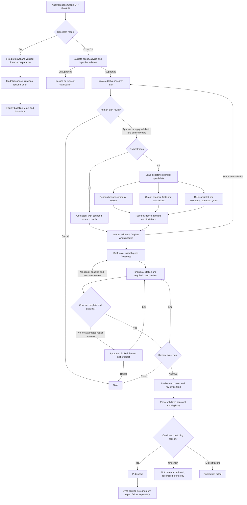

# Program Flow

This diagram distinguishes the C0 response path from gated C1/C2 publication. It describes the principal workflow and required acceptance behavior to preserve during cleanup; it is not proof of live correctness.

MCP hooks enforce tool permissions and budgets. Filing retrieval and EDGAR provide evidence; the Python sandbox computes; the portal alone holds the publication write tool. Checkpoints support resume. Optional memory and reviewed lessons remain separate from protected evaluation answers. Traces/metrics observe execution and do not grant publication permission.

See the [system architecture](architecture.md), [Phase 1 contracts](../migration/phase1/REPORT.md), and [three-story demonstration](../THREE_STORY_DEMO_SCRIPT.md). Live demo actions are outside the offline migration test gate.
